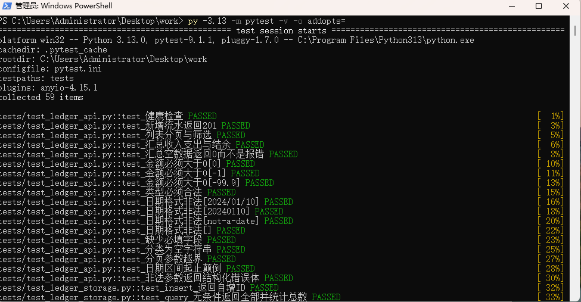
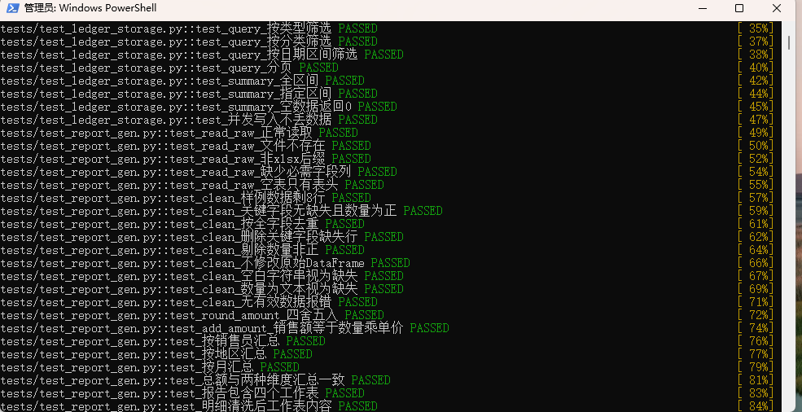
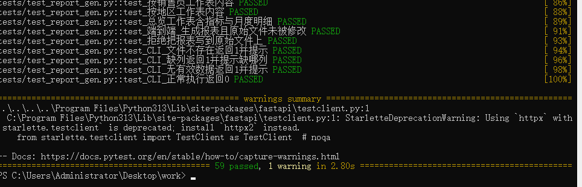
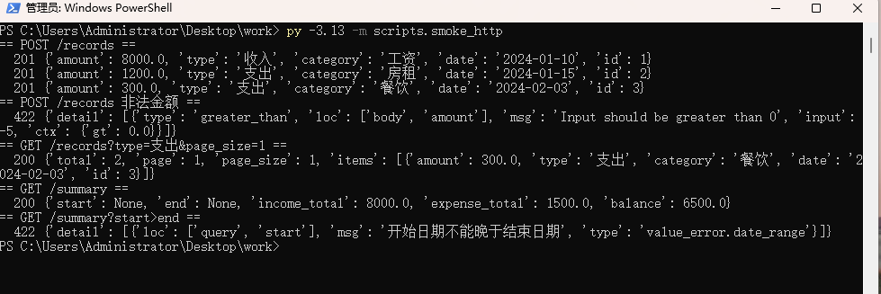

# Python Vibe Coding 实操（lab1）

两个交付件：

1. **考题一**：Excel 报表生成脚本（清洗 `sales_raw.xlsx` → 输出 `report.xlsx` 四个工作表）
2. **考题二**：FastAPI 简易记账服务（`POST /records`、`GET /records`、`GET /summary`）

需求澄清与拍板结论见 [`需求分析.md`](需求分析.md)；
过程记录与复盘见 [`docs/AI协作记录与复盘.md`](docs/AI协作记录与复盘.md)；
逐条代码修改轨迹（含关键 diff 与复核命令）见 [`docs/代码修改轨迹.md`](docs/代码修改轨迹.md)。

## 环境要求

- Python 3.10+（本机验证使用 Python 3.13）
- 依赖：pandas、openpyxl、fastapi、uvicorn、httpx、pytest

```bash
python -m pip install -r requirements.txt
```

> Windows 提示：如果本机默认 `python` 是旧版本（例如 Anaconda 的 3.6），请显式使用 3.13：
> `py -3.13 -m pip install -r requirements.txt`，后续命令同理写成 `py -3.13 -m ...`
> （默认 `python` 版本过低时会直接 `ModuleNotFoundError`）。

## 一、考题一：Excel 报表生成

```bash
# 1)（可选）生成含脏数据的样例数据
python -m src.make_sample_data

# 2) 一键生成报表
python -m src.report_gen --input data/sales_raw.xlsx --output output/report.xlsx
```

输出 `output/report.xlsx`，含四个工作表：

| 工作表 | 内容 |
| --- | --- |
| 明细清洗后 | 清洗后的明细，附销售额列 |
| 按销售员 | 按销售员汇总销售额（降序） |
| 按地区 | 按地区汇总销售额（降序） |
| 总览 | 原始/清洗后/剔除记录数、涉及月份数、销售总额，以及**月度明细** |

清洗规则（与需求澄清结论一致）：

1. 删除关键字段（全部 6 个字段）缺失的行；
2. 剔除数量 ≤ 0 的异常行；
3. 按全字段去重；
4. 销售额 = 数量 × 单价，四舍五入保留 2 位小数。

> 金额口径：**先按行四舍五入到 2 位小数，再按销售员/地区/月份汇总**。
> 因此三种维度的合计与"总览"里的销售总额一致（样例数据均为 6450.00），不会出现汇总差几分的情况。

约束与容错：

- 原始文件以**只读**方式读取，绝不写回（测试中用 MD5 校验）；
- `--output` 与 `--input` 指向同一文件时**直接报错退出**，拒绝覆盖原始数据；
- 文件不存在、非 `.xlsx`、缺少必需字段列、空表、清洗后无有效数据等情况，均给出可读错误并返回退出码 1。

## 二、考题二：FastAPI 记账服务

```bash
python -m uvicorn src.ledger.main:app --host 127.0.0.1 --port 8000
# 或指定数据库：设置环境变量 LEDGER_DB=output/ledger.db
```

接口：

| 方法 | 路径 | 说明 |
| --- | --- | --- |
| POST | `/records` | 新增流水：`amount`(>0)、`type`(收入/支出)、`category`、`date`(YYYY-MM-DD)，成功返回 201 |
| GET | `/records` | 支持 `type`、`category`、`start`、`end` 筛选，`page`/`page_size` 分页 |
| GET | `/summary` | 返回区间内 `income_total`、`expense_total`、`balance` |
| GET | `/health` | 健康检查 |

非法参数统一返回 **4xx + 结构化错误体**（FastAPI 默认 422，`detail` 为数组）：

```json
{"detail": [{"type": "greater_than", "loc": ["body", "amount"], "msg": "Input should be greater than 0"}]}
```

### 并发写入保证

- 每次操作使用独立 SQLite 连接，写操作显式 `BEGIN IMMEDIATE` 事务；
- 开启 `journal_mode=WAL`（读不阻塞写）与 `busy_timeout=5000`（等锁而非直接报错）；
- 由 SQLite 串行化写入，因此并发写不会产生部分写入或脏数据。
- 已验证：8 线程并发写入 40 条，最终记录数 40、金额无重复无丢失（见 `tests/test_ledger_storage.py::test_并发写入不丢数据`）。

## 三、测试

```bash
python -m pytest -v -o addopts=                 # 全量 59 个用例
python -m pytest tests/test_report_gen.py -v -o addopts=
```

> `-o addopts=` 用于覆盖 `pytest.ini` 里的 `addopts = -q`，否则看不到逐条用例名。

完整运行结果见 [`docs/测试运行结果.txt`](docs/测试运行结果.txt)。

真实进程冒烟验证（启动 uvicorn 并调用真实 HTTP 接口）：

```bash
python -m scripts.smoke_http
```

### 运行结果截图

| 场景 | 截图 |
| --- | --- |
| 全量测试开始（collected 59 items） |  |
| 全量测试过程（逐条用例名，中文不乱码） |  |
| 全量测试结果（59 passed） |  |
| 真实 uvicorn 进程冒烟（201 / 422 / 汇总） |  |

## 四、目录结构

```
work/
├── README.md
├── requirements.txt
├── pytest.ini
├── 需求分析.md
├── Python_Vibe_Coding-lab1.docx  # 题目原件（仅供对照，非交付文档）
├── data/sales_raw.xlsx           # 样例原始数据（含脏数据，只读）
├── output/report.xlsx            # 考题一输出
├── docs/                         # 测试运行结果、AI 协作记录与复盘、代码修改轨迹
│   └── images/                   # 运行结果截图（验收证据）
├── scripts/smoke_http.py         # 真实 HTTP 冒烟验证
├── src/
│   ├── make_sample_data.py       # 样例脏数据生成
│   ├── report_gen.py             # 考题一：M1 读取清洗 / M2 统计 / M3 输出 / M4 CLI
│   └── ledger/
│       ├── models.py             # pydantic 模型与校验
│       ├── storage.py            # SQLite 存储（事务 + WAL + busy_timeout）
│       └── main.py               # FastAPI 应用工厂
└── tests/
    ├── test_report_gen.py
    ├── test_ledger_storage.py
    └── test_ledger_api.py
```
